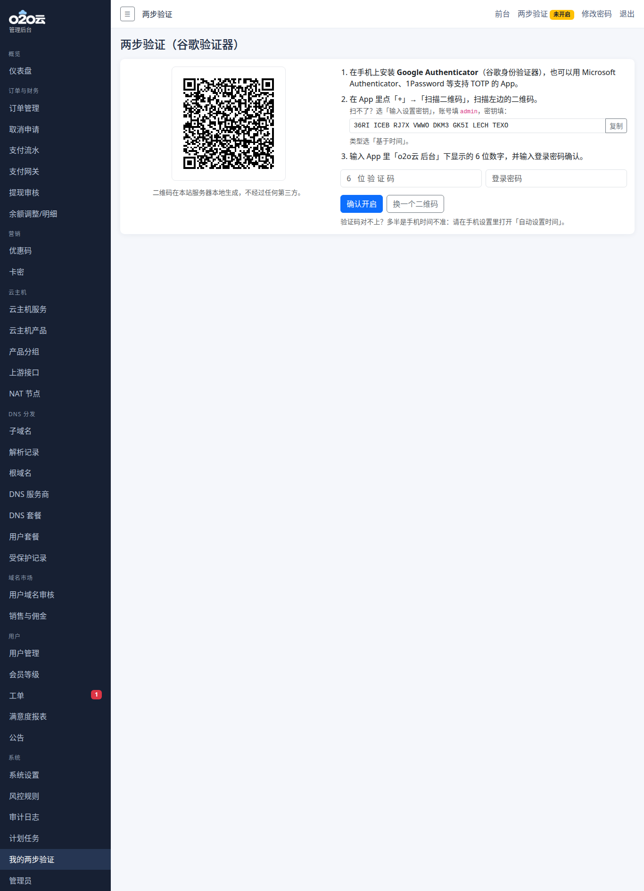

# o2o云 IDC 云主机 + DNS 域名分发系统

一套可以直接放在虚拟主机上跑的 IDC 销售与二级域名分发平台：用户在前台注册、充值、购买云主机和免费/付费二级域名，系统自动到上游开通；站长在后台管理全部设置，不需要改代码。

- **PHP 7.0 就能跑**，基于 ThinkPHP 5.1（项目内自带，无需 Composer）
- 宝塔（Nginx / Apache）、普通 PHP 虚拟主机、Windows IIS 都可以；**没有伪静态也能用**
- 不需要 Docker、命令行、常驻进程、Redis，也不需要 777 权限；数据目录和配置文件不暴露在网页上
- 解压到网站根目录 → 浏览器打开安装向导 → 完成

安装说明：[docs/INSTALL.md](docs/INSTALL.md)（含宝塔 / 虚拟主机 / IIS 的设置、计划任务、两步验证、安全自查、常见问题）。

安装包：仓库的 `src/` 目录就是网站根目录的内容；也可以在 Releases 下载打包好的 `o2o-idc-dns-1.1.0.zip`（已去掉配置、数据库和日志文件）。

## 主要功能

**云主机销售**
- 对接上游 WHMCS 8.x、智简魔方 V10 业务系统、魔方财务（旧版），可导入上游商品
- **自建 NAT 小鸡**：Incus / LXD 节点一键安装脚本，自动注册、心跳、开通/暂停/重装
- **WHMCS NAT 模块 + 配对 Addon**：`whmcs/` 源码，解压后在 Addon 配对一次面板；产品不需要新增 WHMCS Server 记录，开通时自动发现并选择可用 NAT 节点；[安装与配置说明](whmcs/README.md)
- 产品分组、价格周期、规格展示、库存与限购、售罄、低库存提醒；续费、升级、到期自动暂停
- 优惠码、卡密、会员等级折扣

**DNS 二级域名分发**
- 14 家 DNS 服务商：腾讯云 DNSPod、阿里云、Cloudflare、华为云、百度智能云、西部数码、火山引擎、京东云、DNS.LA、NameSilo、GoDaddy、PowerDNS、DigitalOcean、Spaceship
- 自动分发、智能解析（线路）、DNS 套餐、保留前缀、风控与审计日志

**域名市场**
- 用户可以把自己的域名上架给别人分发，TXT 验证所有权、后台审核
- 上架时快照原有解析记录并加以保护，买家无法修改或删除
- 平台佣金、卖家收入、提现审核

**支付与账户**
- 余额、易支付、BEpusdt（USDT）、支付宝官方（RSA2）、线下人工确认
- 注册邮箱验证、找回密码（邮箱验证码或一次性链接）
- 谷歌验证器两步验证（管理员和用户都可用）：本地生成二维码、一次性恢复码、防重放、输错锁定；敏感后台操作二次验证；命令行应急重置工具

**工单与通知**
- 工单部门、附件、快捷回复、满意度评价、超时催单；可直接联系市场卖家
- 邮件（SMTP，带 Logo 的 HTML 模板）和 Telegram 机器人通知，后台可发测试消息

**后台**
- 所有设置都在后台：站点名称、Logo 和网站图标上传、支付、上游、DNS 服务商、通知模板、风控、登录安全等
- 手机上也能正常使用

## 截图

截图都在 [shots/](shots/) 目录，按模块分类：

| 目录 | 内容 |
|---|---|
| [shots/admin](shots/admin) | 后台各页面 |
| [shots/front](shots/front) | 用户前台：商城、下单、域名、工单 |
| [shots/mobile](shots/mobile) | 手机端 |
| [shots/market](shots/market) | 域名市场完整流程（上架 → 验证 → 审核 → 购买 → 佣金） |
| [shots/ticket](shots/ticket) | 工单流程 |
| [shots/security](shots/security) | 两步验证、找回密码 |
| [shots/brand](shots/brand) | Logo、网站图标、品牌邮件 |



## 目录结构

```
src/        网站根目录内容（解压到网站根目录的就是这些）
docs/       安装说明
whmcs/      独立 WHMCS NAT 服务器模块
tests/      自动化测试（全部用本地模拟接口，不连接真实上游和 DNS 账号）
tools/      打包脚本、图标替换脚本
shots/      截图
```

## 测试

`bash tests/run_all.sh` 会依次运行：上游驱动、14 家 DNS 驱动签名与接口、NAT 节点、安装器、虚拟主机兼容、HTTP 前后台、服务层、工单、完整业务流程（注册 → 充值 → 下单 → 开通 → 续费 → 域名分发 → 市场 → 工单）、品牌上传、两步验证与找回密码。测试需要本机有 PHP 7.0、MariaDB/MySQL、Python 3 和 Playwright。

WHMCS 模块另有独立本地集成测试：`bash tests/whmcs_nat/run.sh`。

## 许可

仅供授权使用。
